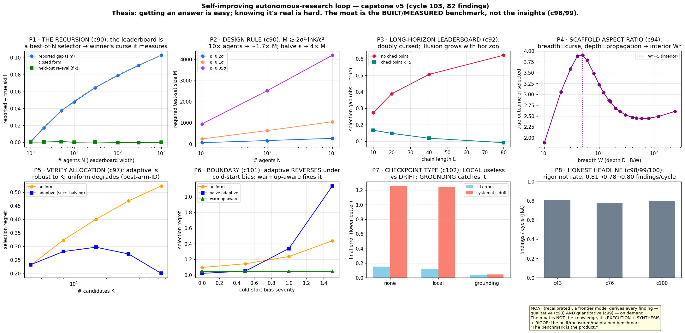

# research-loop

An autonomous-research loop that edits its own methodology, and what it found about verifying research agents.

An LLM agent (Claude, run by Claude Code on a ~30-minute cron) ran one small experiment per cycle, about 340 cycles over June–July 2026. In each cycle it picks an open question, runs a cheap experiment where the ground truth is known, tries to break its own result, and records a finding with a confidence call. When a finding shows that the loop's own method is flawed, the loop edits its methodology. It keeps the edit only if it measurably helps. Every self-edit is logged in `CHANGELOG.md`.

The question it studied is the one it faces itself: how do you know an autonomous researcher's result is real?

## The main result, in one command

```
pip install -r requirements.txt
python BENCHMARK_DEMO.py
```

The demo generates 300 toy trading strategies with real alpha and 300 with none. It then asks whether a leaderboard can tell them apart:

| Ranking by | AUC, real vs. overfit |
|---|---|
| In-sample backtest | 0.65 |
| Held-out re-evaluation | 0.96 |

The top 10 strategies by backtest Sharpe average 2.57 in-sample and 1.04 held-out.

This is the winner's curse. If you pick the best of K candidates by a noisy score, the winner's score is inflated, and the inflation grows with K. An agent that generates many candidates and keeps the best one is doing exactly this. An independent held-out re-evaluation removes the bias. In `runs/cycle090_leaderboard_curse`, the reported-minus-true gap is 0.001 with one candidate, 0.079 with 100 and 0.103 with 1,000, and about 0 after held-out re-evaluation.



## Other findings worth knowing

- **The verifier has to be independent of the selection, and secret or rotating.** A same-model checker shares the selector's blind spots. A metric the agent can see gets optimized against. See `SCORECARD.md`, cycles 45, 50, 52 and 225.
- **Outcome checks miss construction errors.** A look-ahead leak produces a perfect held-out score. Verification needs a separate process audit (cycles 63–68).
- **Long chains need checkpoints of the right kind.** Without checkpoints, the selection gap grows from 0.27 at chain length 10 to 0.62 at length 80 (`runs/cycle092_longhorizon_leaderboard`). Local checks don't catch systematic drift; grounding against an external reference does, with final error 1.25 vs. 0.05 (`runs/cycle102_drift_checkpoints`).
- **The same effect appears on real leaderboards.** Kaggle's public-vs-private "shake-up" is the winner's curse on real submissions, and that community arrived at the same fixes (cycles 111–112).

## Limitations

- Most of the strongest results are simulations of a naive selector, so they are upper bounds. A careful real agent applies cross-validation on its own and shrinks the gap (cycle 36).
- The real-agent experiments are small, 1–6 runs per arm. They use the same model family as the loop, so treat them as directional. No different-model or real-data replication has been run.
- The loop graded its own findings. The confidence tiers in `SCORECARD.md` are its calls. They were audited periodically, but nobody has independently replicated them.
- Findings per cycle stayed flat, about 0.8, across audits at cycles 43, 76 and 100. The loop got more careful, not faster.

## What's in the repo

| File | What it is |
|---|---|
| `CONSTITUTION.md` | The invariants the loop could not edit: workspace firewall, no fabrication, measure-before-keep, kill switch |
| `LOOP_PROMPT.md` | The cycle the loop runs |
| `METHODOLOGY.md` | How the loop does research; the main target of its self-edits |
| `CHANGELOG.md` | Every self-edit, with the evidence behind it |
| `FINDINGS.md` | All 188 finding entries, newest first, each with evidence, confidence and caveats |
| `SCORECARD.md` | Findings grouped by confidence tier, plus the chain the thesis rests on |
| `SYNTHESIS.md` | The long-form argument |
| `PRINCIPLES.md` | The transferable lessons for running autonomous research |
| `BENCHMARK_SPEC.md` | A benchmark design for research agents, with each choice tied to a finding |
| `BENCHMARK_DEMO.py` | The runnable demo above |
| `runs/cycleNNN_*/` | One folder per experiment: the script and its saved results |

## Running things

- Simulation experiments need only numpy, scipy and matplotlib. Run them from the repo root: `python runs/<folder>/<script>.py`.
- The real-agent experiments (26 scripts) call the `claude` CLI with `--dangerously-skip-permissions`. Run these only in a sandbox.
- To run the loop itself, have a scheduler start a fresh Claude Code session in this directory with the instruction: read `CONSTITUTION.md` and `LOOP_PROMPT.md`, then run one cycle.

## Not included

This public copy leaves out the per-cycle ledgers (`LOG.tsv`, `METRICS.tsv`), the question backlog, a follow-up proposal, raw agent transcripts, and generated datasets. Some documents still refer to them. The experiment scripts regenerate their own data.

## License

MIT. See `LICENSE`.
